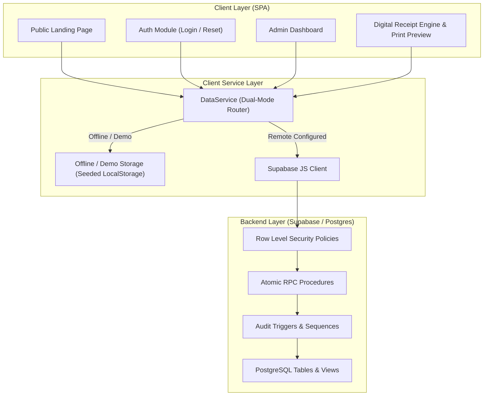

# Architecture Documentation — Dynamo Fitness Club

## System Architecture

## Dual-Mode Operation
To ensure zero friction during local review and offline testing, the system provides an adaptive data layer:
1. **Live Supabase Mode**: Activated when valid Supabase API keys are set in `.env`. Queries execute against PostgreSQL with strict Row Level Security and Atomic RPCs.
2. **Demo Mode**: Enabled out-of-the-box when keys are omitted or set to development placeholders. The system seeds 20 realistic athletes, standard plans, transactions, receipts, and inquiries into localStorage with full reactivity.
